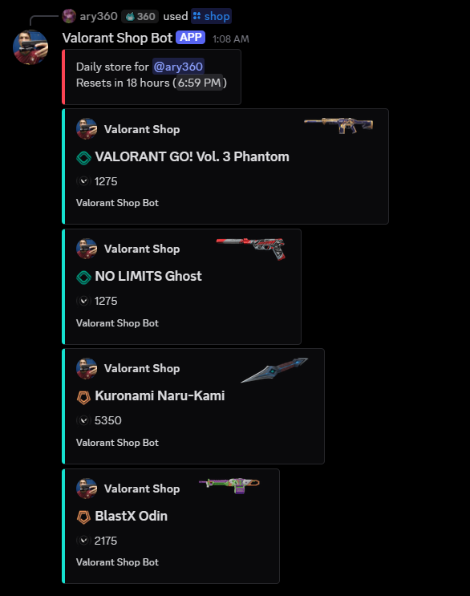
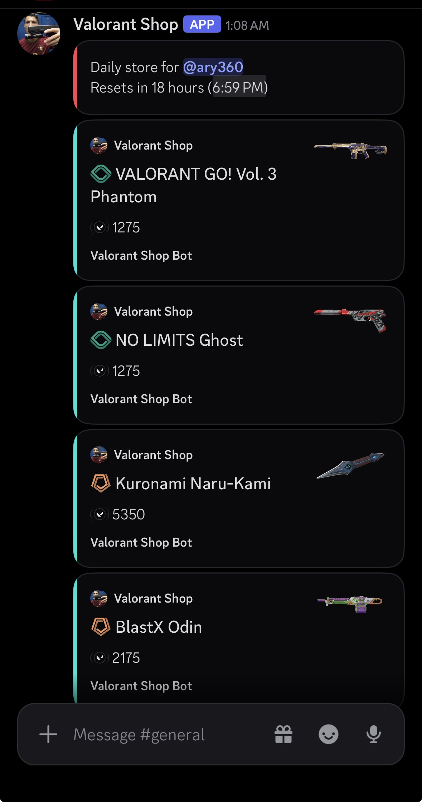

# VALORANT Shop Discord Bot

A Discord bot that shows a player's personal daily VALORANT store directly in Discord. Users link their Riot account once by scanning a QR code with the Riot Mobile app, then run `/shop` to see their four daily skins — name, rarity, price, and art — without opening the game.

Built with Node.js and discord.js.

## Desktop View


## Mobile View


> **Disclaimer:** This project is not affiliated with, endorsed by, or sponsored by Riot Games. It uses Riot's private in-game API, which is against Riot's Terms of Service, and accounts could theoretically be subject to restrictions. Use at your own risk. The bot stores a login *session* only — never a password.

## Features

- **`/shop`** — shows your personal daily store as clean per-skin cards (rarity icon, VALORANT Points price, and skin art), with a live reset countdown.
- **`/link`** — links your Riot account by scanning a QR code in the Riot Mobile app. No password, nothing to paste.
- **`/unlink`** — deletes your stored session from the bot at any time.

Each user sees their own store — the command is personal to whoever runs it.

## How login works

Riot has no official API for the personal store, so the bot mimics Riot's own QR sign-in:

1. `/link` asks Riot for a QR login session and shows the QR code privately in Discord.
2. You scan it with the Riot Mobile app and approve — the same flow Riot supports for the game client.
3. Riot returns a session, which the bot encrypts (AES-256-GCM) and stores, so `/shop` works automatically afterward.

Sessions expire after a few weeks (or when you change your Riot password); the bot then prompts you to run `/link` again.

## Tech stack

- **Node.js** (built-in `fetch`, `https`, `crypto`)
- **discord.js** — Discord API wrapper, slash commands, embeds, and modals
- **qrcode** — renders the login QR
- **valorant-api.com** — community source for skin names, art, and rarity tiers

## Project structure

```
valorant-bot/
├── commands/
│   ├── utility/        # /ping, /server, /user
│   └── valorant/       # /shop, /link, /unlink
├── events/             # ready + interaction handling
├── services/
│   ├── accountStore.js # encrypted per-user session storage
│   ├── qrAuth.js       # Riot Mobile QR login flow
│   ├── valorantApi.js  # reauth + entitlements + storefront fetch
│   ├── skinData.js     # maps store UUIDs to names, art, tiers
│   └── shopService.js  # ties it together for /shop
├── config/             # custom emoji IDs
├── deploy-commands.js  # registers slash commands with Discord
└── index.js            # entry point
```

The data source for `/shop` is isolated behind `shopService.js`, so new features (e.g. stats) can be added without touching the display code.

## Setup

### Prerequisites

- [Node.js](https://nodejs.org) 18 or newer
- A Discord application + bot token ([Discord Developer Portal](https://discord.com/developers/applications))
- A Riot account with the Riot Mobile app set up

### Install

```bash
git clone https://github.com/mamendeary/valorant-bot.git
cd valorant-bot
npm install
```

### Configure

Create a `.env` file in the project root:

```
DISCORD_TOKEN=your-bot-token
CLIENT_ID=your-application-id
GUILD_ID=your-test-server-id
ENCRYPTION_KEY=a-64-character-hex-string
```

Generate the encryption key with:

```bash
node -e "console.log(require('crypto').randomBytes(32).toString('hex'))"
```

### Run

Register the slash commands (run once, and again whenever commands change):

```bash
node --env-file=.env deploy-commands.js
```

Start the bot:

```bash
node --env-file=.env index.js
```

## Notes & limitations

- The bot runs only while the process is running; for always-on use it needs to be hosted.
- Because it relies on Riot's private, undocumented endpoints, it can break when Riot makes changes.
- Prices shown are the VALORANT Points cost returned by the store for that offer.

## Credits

- QR login flow adapted from the open-source [samsepi0l-1337/valorant-bot](https://github.com/samsepi0l-1337/valorant-bot).
- Skin data and art from [valorant-api.com](https://valorant-api.com).

## License

MIT
